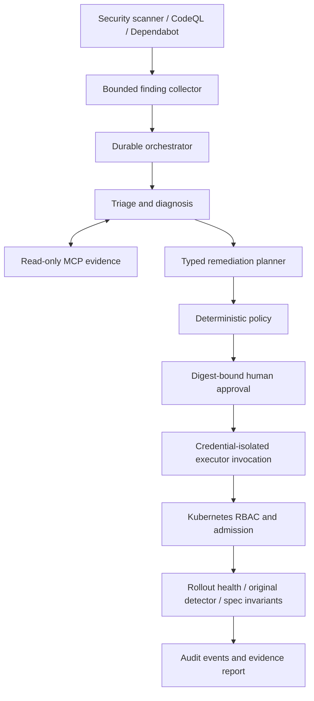

# AI Infrastructure Remediation Platform

An evidence-driven Cloud/SRE automation reference that turns security findings into
bounded remediation plans, human approvals, verified changes, and auditable outcomes.

**The model advises. Policy authorizes. A constrained executor changes infrastructure.
Independent checks determine success.**

This is independently designed open-source reference software with fictional demo
data. It is not an employer implementation and contains no employer-derived systems,
workflows, infrastructure identifiers, or operational data.

## What Works

- Offline mock AI with real MCP client/server communication, durable workflow state,
	separate local operator roles, plan-bound approval, dry-run and evidence reports.
- A fixture backend for a Docker-free demonstration and a separate real kind backend.
- One executable remediation: disable service-account token automount on the
	allowlisted `airp-demo/demo-web` Deployment. Kubernetes admission independently
	rejects changes to images, replicas, annotations or any other non-catalog field.
- Normalized JSON, SARIF/CodeQL, Dependabot and Trivy ingestion. Unsupported repairs
	are explicitly `manual_required`, not silently "fixed" by an LLM.
- Azure OpenAI and OpenAI-compatible structured advice, configured through environment
	variables. No API key or Azure subscription is needed for the mock workflow.
- Tests for denied/expired approval, drift, replay, concurrency, prompt injection,
	provider/tool failure, unhealthy rollout, regression and interrupted execution.

**Not an unattended production operator.** Local identities and SQLite share the
machine administrator's trust domain. See [readiness review](docs/readiness.md)
for verified checks and outstanding production requirements. No passing CI badges
are claimed before the repository has actually run on GitHub.

## Why This Exists

The difficult part of AI remediation is not generating a plausible patch. It is
ensuring the proposed change is authorized, still applicable, bounded in blast
radius, observable, recoverable, and independently verified.

This repository concentrates on that control plane. Broad autonomous host patching,
general-purpose shell agents and automatic source-code repair are deliberately
outside the first release. Each additional action must earn its own safety case.

## Architecture



All seven architecture views are in [architecture](docs/architecture.md): overall,
agent interaction, MCP, security boundary, CI/CD, Kubernetes, and workflow recovery.
[Decisions](docs/decisions.md) explain the tradeoffs and conditions for revisiting them.

## Agent Architecture

| Agent | Contract and responsibility | Safe failure |
| --- | --- | --- |
| Orchestrator | `Finding` + persisted `Run` -> legal state transition | Persist failure or interruption; never blindly replay a write |
| Triage | `Finding` -> `TriageResult`; provider supplies structured advice | Provider errors block analysis; no silent mock fallback |
| Diagnostic | `Finding` + MCP `Snapshot` -> `Diagnosis` | Missing evidence blocks planning; unsupported findings remain manual |
| Remediation | `Diagnosis` + `Policy` -> catalog `Plan` | Cannot generate executable shell or arbitrary patches |
| Risk/Policy | `Plan` + policy -> approval requirement or denial | Recomputed before approval and execution; default deny |
| Validation | Plan + freshly observed snapshot -> `ValidationResult` | Missing or failed checks cannot produce success |
| Reporting | Persisted run and events -> JSON/Markdown evidence | Report failure does not rewrite the remediation outcome |

These are cooperating responsibilities, not seven model wrappers or seven services.
The model is used for advisory triage; diagnosis, planning, policy, execution and
validation for the supported catalog action are deterministic. Source:
[agents](src/airp/agents.py), [orchestrator](src/airp/workflow.py),
[contracts](src/airp/core/models.py).

## MCP Architecture

The official Python MCP SDK serves seven read-only tools over stdio: `workload`,
`vulnerability`, `repository`, `container`, `configuration`, `history`, `validation`.
The client uses real protocol initialization and tool calls, including in mock mode.

Evidence comes from an operator-provided, bounded JSON export. Tool handlers enforce
the exported target/identifier allowlist; there is no filesystem-browsing, arbitrary
HTTP-fetch, shell, Secret-read or mutation tool. Historical examples are fictional
exports, not an implied live vulnerability database. The executor re-reads live
state and rejects a plan whose UID, resource version or spec has drifted.

## Security Model

Every mutation needs a separate approver and executor identity. Approval covers the
canonical plan digest, target UID/version, policy digest, and expiry. Execution is
dry-run unless explicitly requested with `--apply`.

The executor uses a short-lived Kubernetes token with `get` and `patch` on one named
Deployment. A fail-closed admission webhook restricts fields independently of Python
policy. No agent runs generated commands. Bootstrap scripts are trusted operator
tools, not model-accessible capabilities.

Audit events and workflow changes are committed together. Events are hash-linked,
and verification checks the persisted document against the latest event digest.
This is tamper-evident against a retained checkpoint, **not immutable against a
machine administrator**. State, tokens and reports are ignored by Git.

See the [threat model](docs/security.md), [security reporting policy](SECURITY.md),
and [recovery runbook](docs/operations.md).

## Local Setup

Requirements: Git, Make, and [uv](https://docs.astral.sh/uv/getting-started/installation/).
`uv` provisions Python 3.12 and installs the committed dependency lock. Initial
setup needs internet access; the mock analysis itself does not call a model API.

```bash
git clone https://github.com/manideep444/ai-infra-ops.git
cd ai-infra-ops
make setup
make demo-fixture
```

The **fixture demo is explicitly simulated infrastructure**, not evidence of a
cluster change. It uses the same workflow, policy, MCP protocol and validation code.

For **real local Kubernetes**, install Docker with a running engine, kind 0.31+,
kubectl, Helm 3, and OpenSSL supporting `-addext`; allocate approximately 4 CPUs and
6 GB RAM to Docker. Then:

```bash
make setup
make demo
```

This builds the platform image, provisions kind with Cilium, deploys the fictional
workload and admission guard, and runs the workflow. All Kubernetes commands name
the `kind-airp` context explicitly. No Azure resources are created.

Existing clusters are not reset automatically. A second demo after successful
remediation correctly reports that the finding is not reproduced. To demonstrate
another real mutation, explicitly destroy and recreate only the demo cluster:

```bash
make kind-down
make demo
```

## Demo Walkthrough

1. Load seven fictional findings and prioritize critical/high findings first.
2. Run typed advisory triage and gather scoped technical evidence through MCP.
3. Produce manual outcomes for unsupported repair types and a concrete Kubernetes plan.
4. Display its digest, target, action and operational risk; run backend dry-run.
5. Pause for `APPROVE`. Any other response records denial; EOF exits without mutation.
6. Execute with a separate demo executor identity and target precondition tests.
7. Wait for ready, available and updated replicas with the observed generation current.
8. Re-run the original detector and compare the entire resulting spec to the expected spec.
9. Persist a verified or intervention-required outcome and export JSON/Markdown evidence.

For explicitly automated **test** approval, use `uv run airp demo --approve-demo`.
This deliberately uses three local demo identities; it is not proof of real human
identity separation. The normal Make targets do not pass this flag.

## Example Finding, Analysis And Change

The fictional rule `K8S-TOKEN-001` reports an unnecessary API token in `demo-web`.
The mock analysis identifies credential exposure and uncertainty about application
API usage. It does not claim the scanner text proves exploitability.

The generated JSON Patch contains precondition tests plus a single mutation:

```json
[
	{"op":"test","path":"/metadata/uid","value":"<observed-uid>"},
	{"op":"test","path":"/metadata/resourceVersion","value":"<observed-version>"},
	{"op":"add","path":"/spec/template/spec/automountServiceAccountToken","value":false}
]
```

Resource identity and version are real observed values, never model-selected strings.
Disabling automount triggers a rollout and could break a workload that uses the API;
that is why the catalog is limited to the fictional service and approval is required.

## Validation And Audit Report

`succeeded` requires all four checks: original rule resolved, healthy rollout,
unchanged non-catalog spec, and matching target identity. This verifies a specific
configuration repair, not absence of all vulnerabilities or correct business behavior.

Reports in `.state/reports/` contain the original finding, typed analysis, before and
expected state, plan/approval digests, actor attribution, observed state, checks and
audit events. Each report identifies whether its backend was fixture or Kubernetes.

```json
{
	"verified": true,
	"validation": {
		"original_rule_resolved": true,
		"healthy": true,
		"no_regression": true,
		"target_identity_matches": true
	}
}
```

This excerpt illustrates the validation fields; the complete report also carries
identity, timestamps and evidence. Preserve the final audit checkpoint outside the
state directory when using it as independent evidence.

## Kubernetes Architecture

The local cluster contains two namespaces: `airp-system` for admission and operator
service accounts, and `airp-demo` for the two-replica service. Manifests include
ClusterIP Services, ConfigMap content, a runtime-generated demo Secret, resource
requests/limits, readiness/liveness probes, PDBs, restricted pod security, and
network isolation. Cilium implements the NetworkPolicies; kind's default CNI is disabled.

Only token automount is intentionally misconfigured. The demo Secret has no external
value and exists to exercise secret delivery, not to represent a real credential.
The admission server has no Kubernetes API permissions. Local TLS certificates last
seven days and executor tokens last one hour; these are not production rotation mechanisms.

## CI/CD Architecture

- [Quality/integration](.github/workflows/ci.yaml): Python 3.12/3.13, Ruff, strict mypy,
	unit/integration/security tests, dependency audit, wheel build, mock evidence,
	Terraform/Bicep checks, Kubernetes schemas, ShellCheck, actionlint, real kind test.
- [Security](.github/workflows/security.yaml): CodeQL security-extended, container scan,
	CycloneDX SBOM, Terraform misconfiguration scan and repository secret scan.
- [Optional Azure](.github/workflows/azure.yaml): manual dispatch, protected plan/apply
	environments, OIDC, and apply of the exact saved plan from the same workflow run.
- [Dependabot](.github/dependabot.yml): Python lock, Actions, Docker, Compose and Terraform.

Actions are pinned to full commits; default permissions are read-only. Pull-request
jobs have no cloud credentials. Cloud deployment is disabled until an operator
configures identities and protected environments. Branch protection and reviewers
are repository settings, not guarantees provided merely by these YAML files.

## Observability

Structured JSON logs correlate agent events by run ID without dumping raw model
content or tokens. Prometheus metrics track workflow outcomes, remediation outcomes,
agent counts and latency. Run IDs are not metric labels. OpenTelemetry spans include
run IDs and stage boundaries, with optional OTLP export.

```bash
make observe
OTEL_EXPORTER_OTLP_ENDPOINT=http://localhost:4318 make demo-fixture
```

Grafana: `http://localhost:3000`; Prometheus: `http://localhost:9090`. Both are bound
to loopback. Grafana's anonymous access is viewer-only for this local stack.
The dashboard and alerts are provisioned automatically. Stop with
`docker compose -f observability/compose.yaml down`.

CLI metrics are **per-invocation snapshots**, not cumulative service counters. Do not
derive fleet SLOs from them. Durable audit outcomes are the source of truth; a future
continuous worker needs a long-lived metrics exporter. See [operations](docs/operations.md).

## Testing

```bash
make check
make scan
AIRP_TEST_KIND=1 uv run pytest tests/test_kind.py -v
```

The last command requires a fresh provisioned cluster and performs a real approved
change. Tests without that explicit opt-in skip cluster mutation. Local failure
tests cover unavailable LLM/MCP, denied/expired approval, false-positive evidence,
malicious descriptions, modified plans, wrong backends, audit tampering, stale
targets, lock conflicts, write failure, unhealthy rollout, unresolved findings,
non-catalog regressions, and crash-before/after-write reconciliation.

## Configuration

Configuration is environment-based; `.env` files are not loaded implicitly.
See [.env.example](.env.example). Important settings:

| Variable | Default / purpose |
| --- | --- |
| `AIRP_PROVIDER` | `mock`, or `openai` / `azure` |
| `AIRP_ENDPOINT` | Operator-controlled HTTPS provider endpoint |
| `AIRP_MODEL` | Model name, or Azure deployment name |
| `AIRP_API_KEY` | Injected secret for live advice; never required for mock |
| `AIRP_API_VERSION` | Azure API version; verify deployment compatibility |
| `AIRP_BACKEND` | `fixture` or `kubernetes` |
| `AIRP_STATE_DIR` | `.state`; contains private tokens, workflow DB and reports |
| `AIRP_POLICY_FILE` | `policies/local.json`; targets, TTLs and blast-radius limit |
| `AIRP_EVIDENCE_FILE` | Trusted exported evidence bundle for planning |
| `AIRP_TOKEN` | Operator-issued local authentication token |
| `AIRP_KUBECONFIG` | `.state/executor.kubeconfig`; executor invocation only |
| `AIRP_KUBE_CONTEXT` | `kind-airp` |

Scanner adapters consume exports, not live GitHub webhooks. Examples and separate
planner/approver/executor commands are in [operations](docs/operations.md).

## Optional Azure Deployment

Azure is separate from the local demo. [Terraform](terraform/azure/main.tf) provisions
a private AKS API, Cilium overlay networking, separate system/workload pools, private
ACR and Key Vault endpoints, workload federation, managed-identity monitoring and
control-plane audit diagnostics. [Bicep](bicep/monitoring.bicep) separately owns an
optional resource-health alert and notification group.

Read [Azure deployment](docs/azure.md) before enabling the workflow. Provisioning
costs money. The example is not a complete enterprise landing zone and has not been
applied to an Azure subscription as part of local verification.

## Failure Modes And Production Considerations

On ambiguous execution outcomes, stop in `needs_intervention` and retain the target
lock. `reconcile` observes an interrupted `executing` run without replaying the patch.
No automatic rollback is attempted: reversing a security change can be unsafe.
The operator must inspect the target and retain evidence before retiring a stuck lock.

SQLite is intentionally single-host. Multiple control-plane replicas, durable
distributed queues, trusted OIDC human identity, independently retained audit evidence,
certificate automation, policy distribution, and business-level canaries are future
production prerequisites, not hidden features. Admission availability and certificate
expiry are part of the remediation availability budget.

## Design Decisions And Future Work

The current system demonstrates complete bounded execution rather than broad
unverified automation. Next actions should add dependency-update PRs with isolated
tests, image-digest replacement with provenance/compatibility checks, and additional
configuration rules. Each needs approval binding, drift checks, independent validation,
failure tests and a documented recovery strategy before entering the executor catalog.

Further work: remote authenticated MCP, enterprise OIDC, external immutable audit
retention, durable queue/fencing, signed release provenance, long-lived telemetry,
and workload-specific canaries. See [decisions](docs/decisions.md),
[acceptance matrix](docs/acceptance.md), and [readiness review](docs/readiness.md).