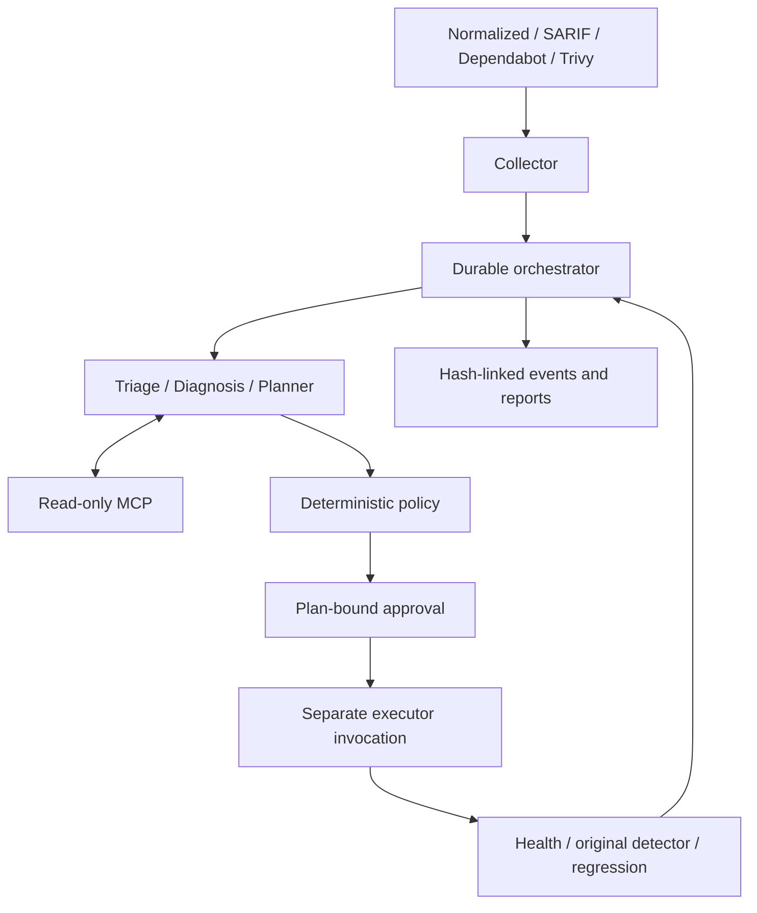
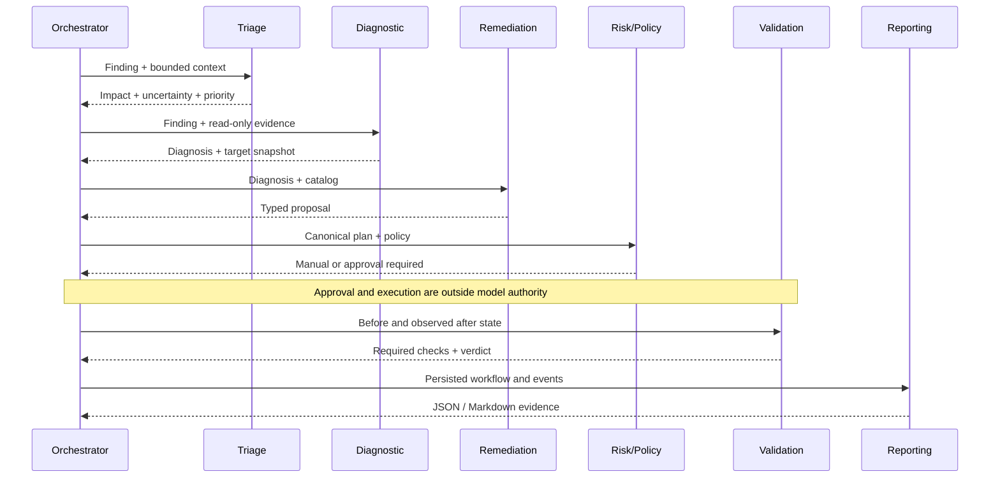
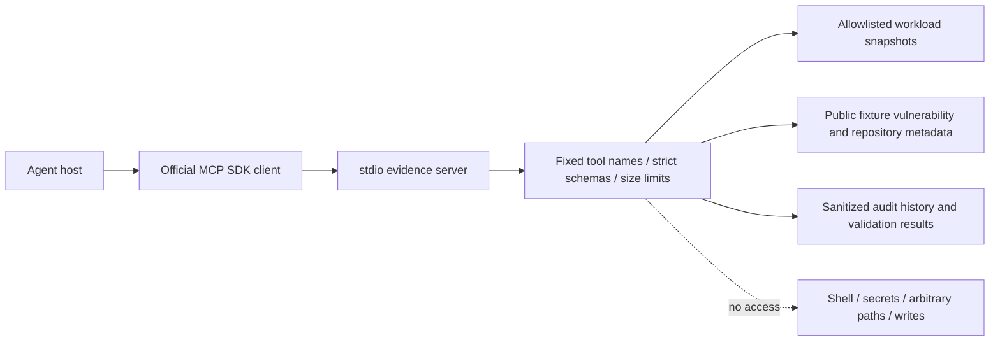
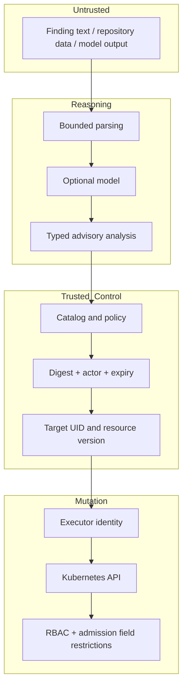
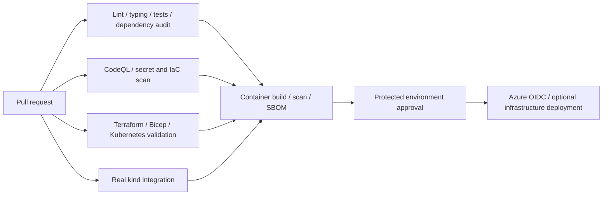
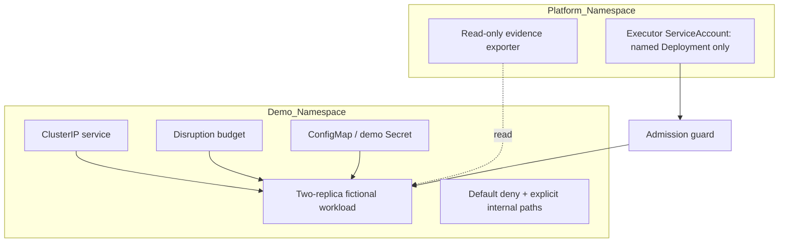
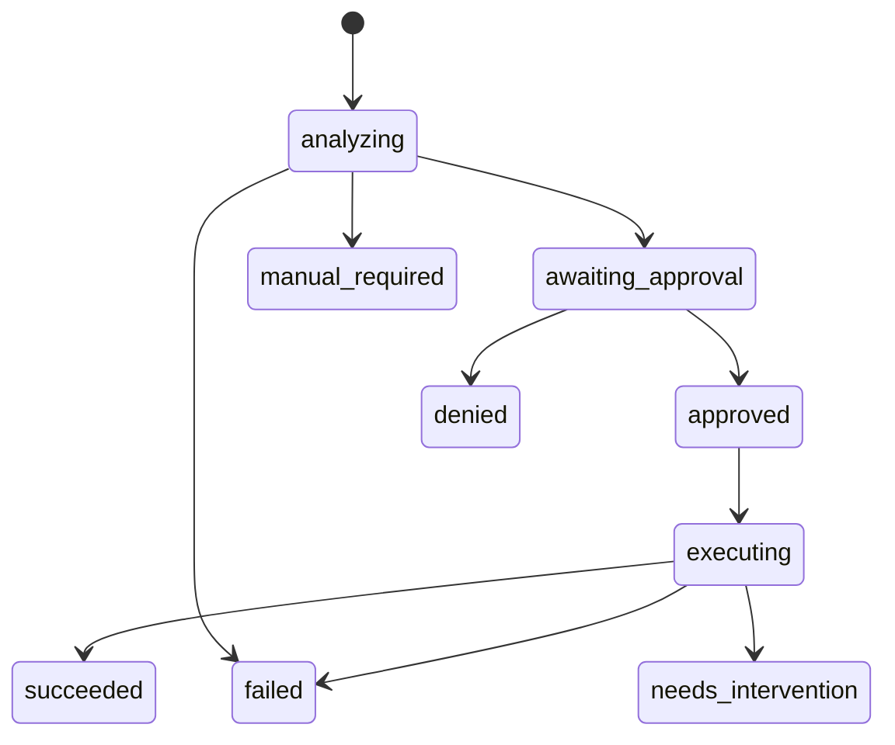

# Architecture

Status: implementation contract. This is independently designed reference software,
not an employer implementation. All demonstration assets are fictional.

## Scope and ownership

The system accepts normalized findings, SARIF, Dependabot and Trivy exports. It
executes one deliberately narrow catalog action: disable service-account token
automount on the named demo Deployment. Everything else produces a manual plan.
Breadth of ingestion is not breadth of authorized mutation. Dependency, image,
OS and source-code repairs require application-specific compatibility evidence;
we do not pretend a generated patch proves that evidence.

Python agents share a typed package, not seven independently operated services.
The CLI is the local control plane. SQLite transactions persist workflow state and
hash-linked audit events. A separately invoked executor owns Kubernetes credentials.
The reasoning process has no mutation tools. MCP serves bounded, read-only evidence.
The first release is single-host, single-worker, not highly available.

## Overall architecture

## Agent interaction

## MCP tools

The server process has no Kubernetes credentials. A trusted operator exports a
snapshot or uses the demo fixture. Evidence is advisory: the executor always
re-reads the target from its own backend before mutation. stdio avoids exposing an
unauthenticated network service; remote MCP hosting is not part of this release.

## Security boundary

Local actor identities come from a token-to-role file controlled by the operator,
not a request field. That demonstrates authorization, not enterprise federation.
A machine administrator can replace local policy, tokens, database and binaries.
Production requires stronger process isolation, trusted identity, artifact
integrity, externally retained audit checkpoints and separate administrative roles.

## CI/CD

## Kubernetes

kind uses a NetworkPolicy-capable CNI. Workload token automount is the intentional
misconfiguration; other workload settings stay hardened. The executor cannot
create workloads, exec into containers, read Secrets, or select another target.
Probe health is necessary but not sufficient: validation also compares all
non-catalog fields against the before-state and re-runs the original detector.

## Workflow and recovery

Dry-run never changes workflow state or target. Approval covers the complete plan,
policy version, actor and expiry. Execution rechecks policy and target UID/version.
Intent is committed before external mutation. Interrupted executing runs are
reconciled, never blindly replayed. Target locks prevent overlapping local writes.
SQLite and Kubernetes cannot share a transaction: exactly-once execution is not
claimed. Unknown outcomes and unsafe recovery require intervention. Automatic
rollback is intentionally absent: rollback can reintroduce a security defect and
requires its own reviewed plan.

## Optional Azure

Terraform owns the resource group, private AKS API, ACR, Key Vault, managed identity,
network and log workspace. Bicep owns an optional monitoring action group only,
inside the Terraform-created resource group. No resource has dual state ownership.
AKS workload identity avoids cloud keys. Private-cluster application deployment
needs a network-connected runner; the hosted OIDC workflow provisions infrastructure
only. Azure is never required for the mock or kind workflows.